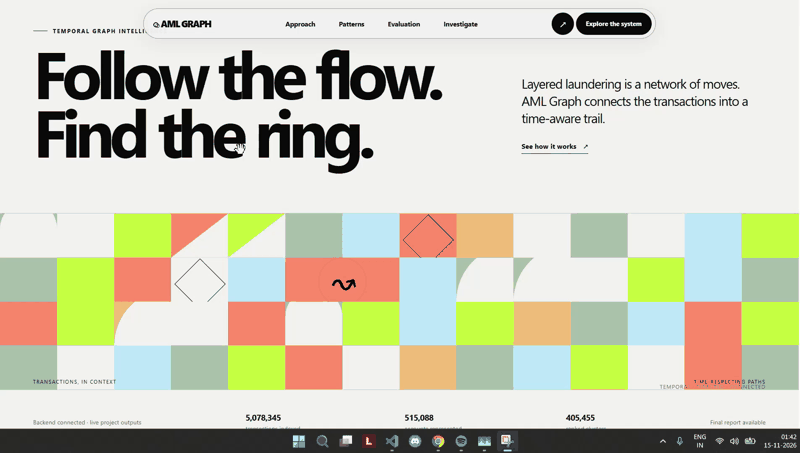
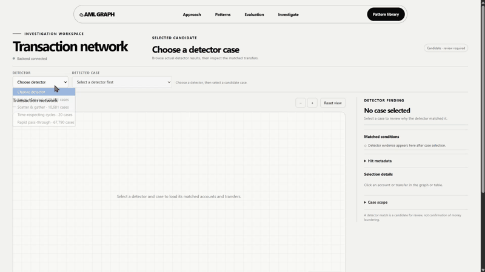

# AML Graph

[](https://www.python.org/)
[](https://github.com/tanishshadow/kajukatli/actions/workflows/ci.yml)
[](#dataset)
[](#current-limitations)

AML Graph is a prototype for spotting suspicious patterns across connected bank transfers. It groups transfers into temporal graph patterns, shows the accounts and evidence behind each candidate, and lets you replay the transfer sequence. A flagged result is a **candidate to review**; it does not prove that money laundering happened.

The implemented contribution is a temporal multigraph pipeline that preserves parallel transfers and orders equal-time events by transaction ID, then combines four deterministic pattern detectors with evidence-linked alerts and a learned cluster risk scorer. The interface lets a reviewer inspect the matched transfers and replay their order. This combines established graph-pattern ideas into a reproducible prototype; it is not a claim of a new AML algorithm or validated banking product.

The four detector commands map to these patterns: `fan` detects fan-in (many accounts sending to one account) and fan-out (one account sending to many); `scatter_gather` detects scatter-gather and gather-scatter layering; `cycle` detects time-ordered loops; and `pass_through` detects rapid transfer chains.



## Who is this for

AML Graph is a research prototype for bank compliance analysts and financial-crime investigators who need to triage connected-transfer alerts, inspect the underlying evidence, and record a review decision. It is not a production monitoring, case-management, or regulatory decision system; analysts must verify candidates using their institution's controls and data.

The analyst workflow ranks saved alert candidates, filters by typology and score, opens a case to review matched transfers and account history, and records Accept or Dismiss with a note. A deterministic, printable case summary is generated from saved evidence. The hosted demo is static and read-only; the local `aml web` workflow is needed to persist analyst decisions.

## Results

Final results are read from the saved M11 report at `outputs/m11/final_report.json`. Account-level results are for the test-period account population. Cluster precision is reported at positive-edge-fraction thresholds; precision at 20 is the precision of the 20 highest-ranked clusters.

| Account-level metric | Result |
|---|---:|
| F1 | 15.1% |
| Precision | 10.9% |
| Recall | 24.8% |
| PR-AUC | 15.2% |

| Cluster positive-fraction threshold | Alert clusters | Precision | Precision at 20 |
|---:|---:|---:|---:|
| 0.3 | 2,612 | 10.5% | 100.0% |
| 0.5 | 2,612 | 10.5% | 100.0% |
| 0.7 | 2,612 | 6.2% | 100.0% |

Attempt edge recall uses a 50% edge-coverage threshold. ?Not covered? means the detectors do not evaluate that typology.

| Typology | Attempts | Detected | Edge recall |
|---|---:|---:|---:|
| Cycle | 10 | 5 | 50.0% |
| Fan-in | 12 | 2 | 16.7% |
| Fan-out | 10 | 0 | 0.0% |
| Gather-scatter | 16 | 0 | 0.0% |
| Scatter-gather | 11 | 9 | 81.8% |
| Stack | 7 | 0 | 0.0% |
| Bipartite | 17 | Not covered | Not covered |
| Random | 12 | Not covered | Not covered |

The test period contained 1,015,882 transactions, including 1,798 labeled positive transactions, and 95 attempts starting in the period. These are synthetic benchmark results, not evidence of real-world effectiveness. The investigation replay below shows the kind of evidence the prototype presents for a candidate.



## Clone and install

```bash
git clone https://github.com/tanishshadow/kajukatli kajukatli
cd kajukatli
python3 -m venv .venv
source .venv/bin/activate
pip install -e .
```

```powershell
git clone https://github.com/tanishshadow/kajukatli kajukatli
cd kajukatli
py -3.13 -m venv .venv
.\.venv\Scripts\Activate.ps1
python -m pip install -e .
```

## Dataset

Get the HI-Small dataset from either [Kaggle](https://www.kaggle.com/datasets/berkanoztas/transactions-data) or [IBM's dataset page](https://github.com/IBM/AML-Data). Kaggle may require an account. The current preparation step requires these files in the project root:

```text
HI-Small_Trans.csv
HI-Small_Patterns.txt
```

`HI-Small_accounts.csv` is optional. Raw files remain unchanged. Prepare the processed files with:

```bash
aml prepare --config backend/configs/default.yaml
```

## Run the local demo

Create detector results for the investigation page:

```bash
aml detect --detector fan --config backend/configs/default.yaml
aml detect --detector scatter_gather --config backend/configs/default.yaml
aml detect --detector cycle --config backend/configs/default.yaml
aml detect --detector pass_through --config backend/configs/default.yaml
```

Start the combined backend and website:

```bash
aml web --config backend/configs/default.yaml
```

Open **http://127.0.0.1:8765/**, the [alert queue](http://127.0.0.1:8765/queue.html), or the [investigation page](http://127.0.0.1:8765/investigation.html). The backend runs locally; it is not hosted. The full pipeline and case data are available when you prepare the HI-Small dataset and run the detector commands above. On Windows, press `Ctrl+C` in PowerShell to stop the server. To use another port, add `--port 8766`.

The investigation page requires the local backend and detector outputs. When you run `aml web`, the backend reads locally prepared transaction files and detector outputs, then fetches only the selected case's transfers for the graph. It does not send the full dataset to your browser. The graph shows accounts, transfers, timing, detector evidence, and benchmark labels.

The analyst queue uses the saved M8 ranked-alert export and saved M11 report. You can filter the exported candidates, open a case to review its matched transfers and account history, and save an Accept/Dismiss decision with a note. Decisions are stored locally in `outputs/review/decisions.json`; printable case summaries use the saved deterministic narrative and evidence.

## Static hosted demo and deployment

The repository includes a static read-only showcase at [`docs/index.html`](./docs/index.html). It contains at most three saved sample cases per detector and twenty transfers per case. The committed `docs/demo-data.json` is a small, transformed excerpt from the synthetic IBM HI-Small benchmark; it does not contain the raw dataset or model artifacts. The page labels the excerpt and credits IBM. The excerpt is shared under [CDLA-Sharing-1.0](https://cdla.io/sharing-1-0/); review IBM's [dataset notice](https://github.com/IBM/AML-Data/blob/main/README.md) before redistributing it.

To regenerate the bounded JSON from your local prepared Parquet and saved detector outputs:

```bash
aml demo-bundle --config backend/configs/default.yaml
```

The command requires the four detector hit exports and prepared account/transaction Parquet locally. Raw files and full outputs remain local and ignored by Git; inspect the generated `docs/demo-data.json` before publishing. The static page only reads this small JSON file and has no API, write endpoint, or outside AI dependency.

GitHub Pages is deploy-ready through [`.github/workflows/pages.yml`](./.github/workflows/pages.yml). In repository **Settings → Pages**, select **GitHub Actions** as the build and deployment source, then push to `master` or run the workflow manually. It publishes only `docs/`; the deployed landing page is `docs/index.html`. For another static host, publish the contents of `docs/` as the site root. The [pitch brief](./docs/PITCH.md) summarizes the intended user, measured results, caveats, and roadmap.

## Run tests

After activating the virtual environment, run:

```bash
pytest -q
```

```powershell
python -m pytest -q
```

Tests run automatically on GitHub Actions and do not require the dataset.

## Evaluation integrity

The system uses a temporal split: train data sets detector/model parameters, validation data selects the alert cutoff, and the frozen setup is measured on the final test period. `aml report` performs that final evaluation and is guarded against a second run under a changed configuration. Avoid running it casually; use the saved report and the [Evaluation page](http://127.0.0.1:8765/evaluation.html) for existing results.

Regenerate confidence intervals, validation ablations, validation evasion curves, and the separately labeled post-hoc test baseline with:

```bash
aml evaluation-artifacts --config backend/configs/default.yaml
```

The command verifies the saved final report's frozen hash and leaves that report and frozen configuration unchanged. It computes ablations and evasion results on train/validation data, then evaluates the already train-tuned threshold baseline on test-period transactions only as a separate post-hoc comparison. It writes derived JSON and Markdown under `outputs/evaluation/` and `outputs/posthoc/`, plus the validation evasion files at `outputs/evasion.json` and `outputs/evasion.csv`.


### Test-period disclosure

The test period was evaluated twice before the one-run safeguard was added. After the first run, scoring and evasion settings changed and score-report formatting was updated. The earlier output is kept under `outputs/m11/archived_exploratory/` and is exploratory, not the final result; it has no recorded configuration hash. The final report was reconstructed from the prepared data and frozen model artifacts, and its hash matches the frozen hash recorded by the Evaluation page. The first report attempt failed while serializing cluster metrics after calculating them; recovery reran the same frozen configuration. The final report and `outputs/m11/FINAL_RUN_STARTED.json` record that recovery.

## Current limitations

- HI-Small is synthetic; real-world effectiveness has not been established.
- Some evaluation comparisons are unfinished. The saved final report is reduced; missing comparisons should not be interpreted as passing.
- Fan-out and gather-scatter have detector logic but recorded test edge recall is 0% at the 50% attempt-coverage threshold (fan-out 0/10; gather-scatter 0/16). The next step is to investigate candidate generation and stage linkage and validate any changes on the validation period before a future frozen evaluation.
- Stack attempts are evaluated but none were detected (0/7 at that threshold), and there is no dedicated stack detector yet. A separate sequential-stacking detector, test fixtures, and validation are roadmap work, not claimed capability.
- Recall varies by pattern, and some benchmark typologies (including bipartite and random) are not covered.
- Summaries use an offline deterministic template; no outside AI service or API key is connected.
- Very large detected cases may be shortened in the graph view; the page reports when transfers are omitted.

## Data credit

The HI-Small benchmark comes from IBM's synthetic financial-transactions work. See the [research paper](https://proceedings.neurips.cc/paper_files/paper/2023/hash/5f38404edff6f3f642d6fa5892479c42-Abstract-Datasets_and_Benchmarks.html) and IBM's [dataset information and license](https://github.com/IBM/AML-Data/blob/main/README.md) before sharing the dataset or a hosted copy. Raw data and full generated outputs are excluded from Git; the only checked-in data excerpt is the bounded, attributed `docs/demo-data.json`, shared under [CDLA-Sharing-1.0](https://cdla.io/sharing-1-0/).
